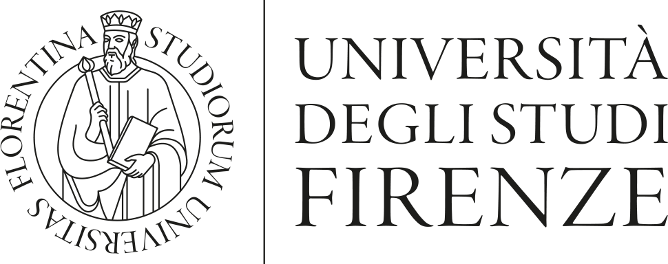

# CamillaBraghiroli.github.io

I have a Bachelor's degree in __Humanities for Communication__ from the [University of Florence](https://www.unifi.it/it)  and I'm currently studying __Corporate Communication__ at [University of Milan](https://www.unimi.it/it) 

I’m really into indie magazines, which is why I follow the [Mag to Mag festival](https://magtomag.com/?srsltid=AYCX9vLvbSCGrPikbiaOBWpjkeO3ZzL_t2v8ALkXUc5bHf7Yz7rKkBHr) every year.

