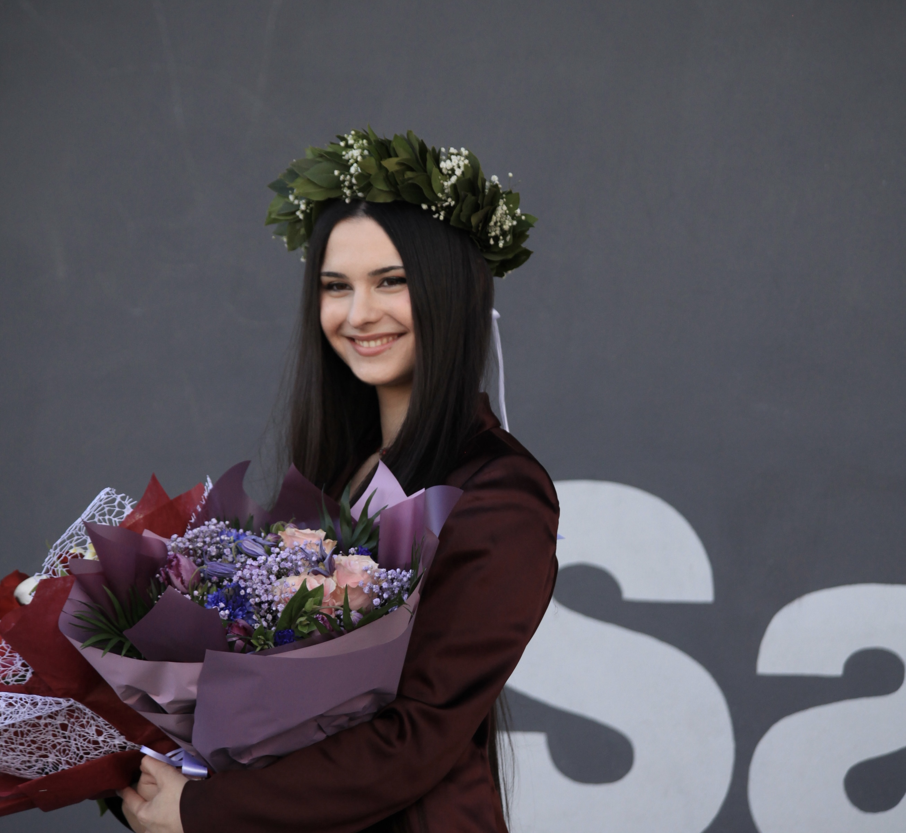
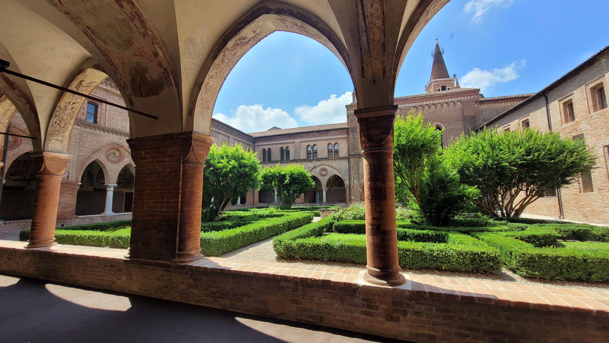
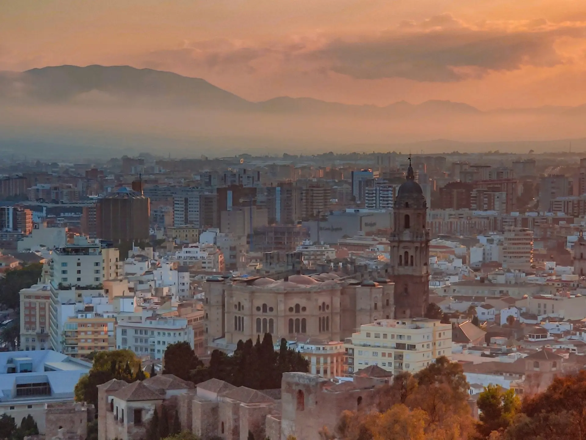
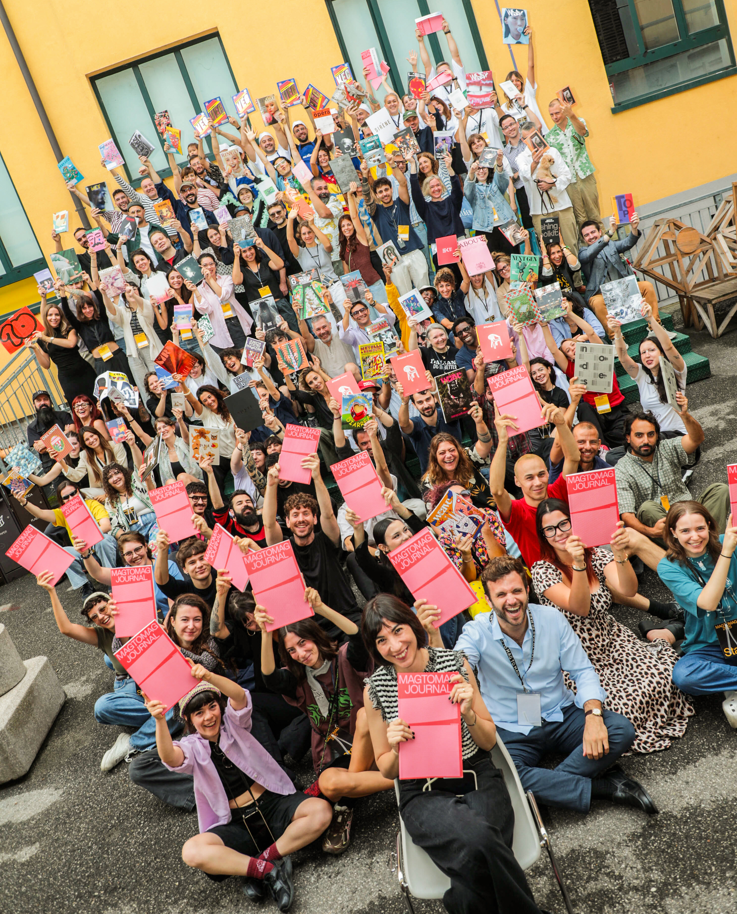

# Camilla Braghiroli
· Communication Student · 

📍 San Benedetto Po (MN), Italy  |  ✉️ camilla@braghiroli.it  |  📞 +39 331 110 4948

## About Me

  

I'm a master's student with a bachelor's degree in Humanistic Sciences for Communication from the [University of Florence](https://www.unifi.it/it/studia-con-noi/corsi-di-laurea/corsi-di-laurea-triennali-e-a-ciclo-unico/scienze-umanistiche-la).

During my third year, I studied at the [University of Málaga](https://www.uma.es/facultad-de-ciencias-de-la-comunicacion/) through the Erasmus+ programme, where I fell in love with Andalusian culture. That experience helped me reach a C1 level in Spanish, and exploring the culture of the Spanish-speaking world remains one of my greatest passions.

Languages: Italian (native) · Spanish · English 

## Experience

  

### Tourist Information & Visitor Services Assistant

San Benedetto Po · Present

Welcome national and international visitors, offering guidance on local attractions, events, itineraries and accommodation.
Manage ticket sales and the bookshop.

### Editorial Intern — [Frab's Magazine & Mor](https://frabsmagazines.com/)

Milan · 12/09/2025 – 09/10/2025

Contributed to communication, marketing and promotion activities for cultural projects.
Supported the organisation of Mag to Mag, the independent magazine festival, and published content on the blog.
Coordinated the Frab's pop-up shop at Fashion Graduate Italia, independently handling sales and visitor reception.
Wrote an article for the website: ["Uno squarcio nel sipario: il festival dagli occhi dei volontari"](https://frabsmagazines.com/blogs/frabs-blog/uno-squarcio-nel-sipario-il-festival-dagli-occhi-dei-volontari?srsltid=AY6E9610JQ4VfFO59u2OWCD90DEHQ1Gjds-zkffYdAkZhxf20WUhtO8T). 

### Article Writer — [UltimaVoce](https://www.ultimavoce.it/)

Remote · 01/2023 – 04/2023

Wrote articles on current affairs and culture, focusing on youth, women's rights and empowerment.
[Read my publications](https://www.ultimavoce.it/?s=Camilla+Braghiroli).

## Education

### Master's Degree

Corporate Communication · University of Milan · 2026 – Present

### Bachelor's Degree in Humanistic Sciences for Communication

University of Florence · 2022 – 2025 · 110/110

  

### Erasmus+ — Universidad de Málaga

Málaga, Spain · 2024 – 2025

Coursework carried out entirely in Spanish, including:

- An advertising campaign for a second-hand clothing store.
- Articles and film reviews written in the target language.
- Character development and screenwriting for a TV series episode.
- A full campaign for the [Monkey Week music festival](https://monkeyweek.org/en/): logo, posters, festival signage and audiovisual content.

### Diploma — Liceo Linguistico Virgilio

Mantova · 2017 – 2022 · 100/100

61st Merit Award from Confindustria Mantova, given to students graduating with top marks in the 2021–2022 academic year.
Commendation letter for academic merit (2021/2022) from the Liceo Classico e Linguistico Virgilio.

## Interests

  

Independent magazines · I'm really into indie magazines, which is why I follow the Mag to Mag festival every year, and why I volunteer there.

📬 Let's connect!   camilla@braghiroli.it

